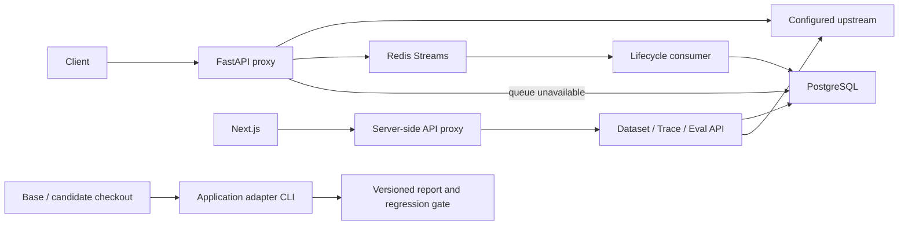

# 实际架构

单机实现：API 内启动消费者，唯一消费者名称、pending 重领、稳定 ID 与数据库幂等；未实现分布式调度。评测逐条执行，远端调用有超时，数量较多时应使用 CLI 或扩展作业队列。

数据库保存 Trace、Span、GoldenDataset、GoldenCase、EvalRun。pgvector 镜像可用，但当前没有向量字段或向量检索功能。基线比较使用数据集 hash 和裁判配置校验，识别通过率下降及逐用例退化。

代理支持文本 messages；多轮原始 messages 存入 metadata_extra。RAG/工具应用需要业务 adapter 重放真实流程，单纯重放模型 messages 不能替代知识库版本验证。
